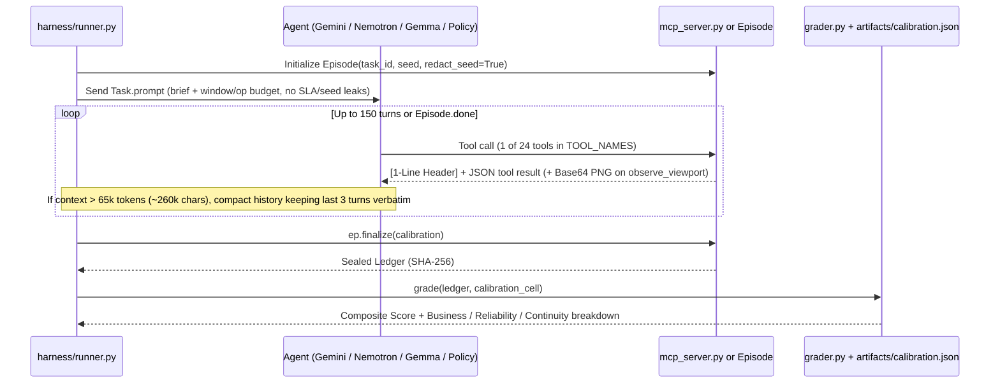

# Teammate 2 — MCP Server & Frontier Agent Evaluation Harness (Runner, Gemini 4 + Image Blueprint + Decisions API, Nemotron 3.5 VL)

## 1. Mission & Scope

> **Language Standard:** Implement **all code, agents, MCP servers, and CLI entrypoints in pure Python (>= 3.11)** whenever possible. Do not introduce Node/TypeScript MCP wrappers or shell-script runners; use Python's `mcp` SDK and stdlib (`json`, `sys`, `urllib`, `asyncio`) directly.

You own **Track 2 (MCP Server & Frontier Model Evaluation Harness)** of **TerrariaBench**.
The core world engine ([engine.py](file:///C:/Users/natha/dev/TerrariaBench/terraria_bench/engine.py)), task lenses ([tasks.py](file:///C:/Users/natha/dev/TerrariaBench/terraria_bench/tasks.py)), composite grader ([grader.py](file:///C:/Users/natha/dev/TerrariaBench/terraria_bench/grader.py)), provenance ([provenance.py](file:///C:/Users/natha/dev/TerrariaBench/terraria_bench/provenance.py)), and the 24-tool `Episode` session ([tools.py](file:///C:/Users/natha/dev/TerrariaBench/terraria_bench/tools.py)) are already complete and frozen.

Your responsibility is to expose the 24 tools over the **Model Context Protocol (`mcp_server.py`)** and build the **Multi-Model Evaluation Harness** (`runner.py`, `gemini_agent.py`, `nemotron_agent.py`) capable of running live LLM API trials as well as deterministic offline/cached evaluation (`python -m terraria_bench.harness.runner --eval-standard`).

### Files You Own (No Overlap With Teammates 1, 3, 4)
| File Path | Purpose |
| :--- | :--- |
| `terraria_bench/mcp_server.py` | FastMCP / stdio & JSON-RPC MCP server exposing all 24 tools in `tools.py` for Goose, Claude Code, OpenCode, and Harbor |
| `terraria_bench/harness/__init__.py` | Harness package exports (`AgentProtocol`, `EpisodeRunner`, `run_eval_standard`) |
| `terraria_bench/harness/runner.py` | Main benchmark runner (150-turn cap, context compaction at ~65k tokens keeping last 3 turns verbatim, trajectory exporter, and `--eval-standard` Rich leaderboard printer matching StoreBench Tables 1 & 3) |
| `terraria_bench/harness/gemini_agent.py` | Google Gemini (`google-genai` SDK) multimodal agent + Gemini Image Blueprint Planner (`build_blueprint` matrix synthesizer) + Gemini Decisions API (`gemini-decision-1`) wrapper |
| `terraria_bench/harness/nemotron_agent.py` | NVIDIA Nemotron 3.5 Super VL (`nvidia/nemotron-3.5-super-vl` / `nvidia/nemotron-3.5-lightning-30b-a3b`) agent via OpenAI-compatible client (`integrate.api.nvidia.com/v1` + OpenRouter fallback) with 40 RPM exponential backoff |

---

## 2. Architecture & Data Flow



### Shared Foundation Imports
- `from terraria_bench.tools import Episode, TOOL_NAMES, TOOL_SCHEMAS`
- `from terraria_bench.tasks import TASKS, EVAL_TASKS, TRAIN_TASKS, REPORTED_SEEDS`
- `from terraria_bench.grader import grade, components, dense_rewards, training_reward`
- `from terraria_bench.provenance import load_calibration, write_sealed, ARTIFACTS_DIR`

---

## 3. Detailed Module Specifications

### 3.1 `terraria_bench/mcp_server.py` — 24-Tool MCP Server

Must support two execution modes so it works everywhere even if the `mcp` package is not installed in a minimal Python environment:
1. **FastMCP mode** (when `mcp.server.fastmcp.FastMCP` is available):
   - Registers all 24 tools from `TOOL_NAMES` dynamically or explicitly with proper type annotations matching `Episode._tool_<name>` signatures.
   - Each tool call invokes `ACTIVE_EPISODE.step(tool_name, **kwargs)` and returns `res["text"]` (which starts with the deterministic 1-line status header `[Seed: ... | Win: ... | Ops: ...]`).
2. **Stdlib JSON-RPC 2.0 stdio fallback** (when `mcp` is not installed or `--stdio-jsonrpc` is passed):
   - Reads newline-delimited JSON-RPC 2.0 requests (`initialize`, `tools/list`, `tools/call`) from `sys.stdin` and writes responses to `sys.stdout`.
3. **CLI entrypoint (`python -m terraria_bench.mcp_server`)**:
   - Flags: `--task first-night`, `--seed 7`, `--redact-seed` (sets `Episode(..., redact_seed=True)` so the world seed is not leaked in the status header during official evaluations), `--export-ledger path.json` (writes the sealed ledger on exit).

---

### 3.2 `terraria_bench/harness/runner.py` — Main Benchmark Runner & Leaderboard

#### Core Responsibilities:
1. **`CompactHistory` (StoreBench §5 / §7 Protocol)**:
   - Enforces a hard **150-turn cap** per episode (`MAX_TURNS = 150`).
   - Tracks estimated token count (`chars // 4`). When history exceeds **65,000 tokens**, compacts earlier turns into a structured state summary (milestones unlocked, last known ore/chest coordinates, current window/HP/inventory summary) while **keeping the last 3 turns verbatim**.
2. **`run_agent_episode(agent, task_id: str, seed: int, calibration: dict | None = None, max_turns: int = 150) -> dict`**:
   - Creates `ep = Episode(task_id, seed, redact_seed=True)`.
   - Feeds `ep.task.prompt` as the initial observation (never leaks `task.sla`, `task.events`, or grading formulas).
   - Loops up to `max_turns` while `not ep.done`:
     - Asks `agent.next_action(observation, ep)` for `(tool_name, tool_args, metadata)`.
     - If agent returns `None` or declares completion early, breaks out of loop and calls `ep.finalize(calibration)` (per StoreBench §5: premature quitting is scored as played!).
   - Saves sealed trajectory and ledger to `artifacts/runs/<agent_name>/<task_id>_seed<seed>.json`.
3. **`--eval-standard` CLI (`python -m terraria_bench.harness.runner --eval-standard`)**:
   - Loads `artifacts/calibration.json` (or auto-invokes `terraria_bench.calibrate.calibrate_all()` if missing).
   - Evaluates and prints two StoreBench-formatted tables (using `rich.table.Table` if installed, with clean ASCII table fallback):
     - **Table 1 (Main Evaluation Leaderboard across 8 Eval Tasks × Seeds 7, 11, 13)**:
       - Scripted anchors (`smart-triage`, `rule-based`, `blast-list`, `absentee`, `do-nothing`, `exploiter`) computed directly from the real grader.
       - Frontier & Open-Weight Agents (`Gemini 4 / 2.5 Pro`, `Nemotron 3.5 Super VL`, `Gemma 4 Base`, `Gemma 4 Tuned`) and `Human experts`:
         - Loads real graded trajectories from `artifacts/runs/` (or runs live API calls when `--live` and API keys `GEMINI_API_KEY` / `NVIDIA_API_KEY` are present; when keys or recordings are absent, clearly marks live model rows as `not run (set API key or --live)` or loads recorded sample trajectories without ever fabricating fake LLM scores).
     - **Table 3 (Post-Training Transfer Summary: Gemma Base vs. Tuned)** showing `Composite`, `Pass`, `Business`, `Reliab.`, `Contin.`, `Survival`, `SLA`, `Windows`.

---

### 3.3 `terraria_bench/harness/gemini_agent.py` — Gemini 4 + Image Blueprint + Decisions API

Must integrate three capabilities via `google-genai` (`from google import genai`):
1. **Multimodal Tool Agent (`GeminiAgent`)**:
   - Configurable model ID via `os.environ.get("TERRARIA_GEMINI_MODEL", "gemini-2.5-pro")` (supporting `gemini-4` aliases).
   - Sends the task prompt, 1-line status header, JSON tool output, and when `observe_viewport` was called, decodes `viewport_png_b64` into an inline `types.Part.from_bytes(data=..., mime_type="image/png")` alongside the `61x35` ASCII grid.
2. **Gemini Image Blueprint Synthesizer (`synthesize_blueprint_matrix`)**:
   - Configurable image model via `os.environ.get("TERRARIA_GEMINI_IMAGE_MODEL", "gemini-2.5-flash-image-preview")`.
   - When the agent calls `build_blueprint` for a custom structure, prompts the image/spatial model to generate a structural schematic and parses it into a valid 2D tile matrix (`WOOD=3`, `PLATFORM=4`, `DOOR=19`, `WORKBENCH=12`, `TORCH=16`, `CAMPFIRE=15`, `AIR=0`), verifying flood-fill closure before placement.
3. **Gemini Decisions API Wrapper (`GeminiDecisionsWrapper`)**:
   - Uses `client = genai.Client(http_options={"api_version": "v1beta"})` and model `os.environ.get("TERRARIA_GEMINI_DECISION_MODEL", "gemini-decision-1")`.
   - Calls `client.decisions.create(model=..., input=[...], questions={...})` with question types:
     - `"choice"` (2–255 candidate macro-actions, returning winner + normalized probability distribution + confidence `0..1`),
     - `"score"` (rubric evaluation of shelter/boss-readiness risk from `0..N`),
     - `"bool"` (yes/no readiness check, e.g., whether to summon Eye of Cthulhu tonight; gracefully falls back to `generate_content` with structured JSON schema if the `decisions` endpoint is unavailable on the user's API tier).
   - Logs decision confidence and risk/utility trade-offs via `record_tactical_checkpoint`.

---

### 3.4 `terraria_bench/harness/nemotron_agent.py` — NVIDIA Nemotron 3.5 Super VL

1. **Client Configuration**:
   - Uses `openai.OpenAI(base_url=os.environ.get("NVIDIA_BASE_URL", "https://integrate.api.nvidia.com/v1"), api_key=os.environ.get("NVIDIA_API_KEY", ""))` with automatic fallback to OpenRouter (`https://openrouter.ai/api/v1` via `OPENROUTER_API_KEY`).
   - Model ID configurable via `os.environ.get("TERRARIA_NEMOTRON_MODEL", "nvidia/nemotron-3.5-super-vl")` (with fallback alias `nvidia/nemotron-3.5-lightning-30b-a3b`).
2. **Rate-Limit Backoff (40 RPM handling)**:
   - Implements deterministic/jittered exponential backoff (`base=2.0s, max_retries=6`) on HTTP `429` / `5xx` responses.
3. **Multimodal + Tool Calling**:
   - Formats `viewport_png_b64` as `{"type": "image_url", "image_url": {"url": f"data:image/png;base64,{b64}"}}` alongside the symbolic ASCII grid and 24 OpenAI function schemas generated from `TOOL_SCHEMAS`.

---

## 4. Verification Checklist Before Merging

Run:
```powershell
python -m terraria_bench.mcp_server --help
python -m terraria_bench.harness.runner --eval-standard
```
- [ ] `mcp_server.py` responds to JSON-RPC `tools/list` with all 24 tools and executes `tools/call` returning the 1-line status header.
- [ ] `python -m terraria_bench.harness.runner --eval-standard` runs cleanly in < 10 seconds, verifies all 6 anchor rows (`do-nothing = 0.000`, `absentee = 0.100`, `exploiter < 0.050`), and renders the StoreBench Table 1 & Table 3 leaderboards.
