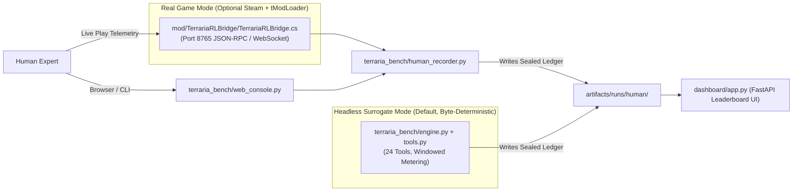

# Teammate 4 — Game Bridge Server, Human Telemetry Recorder, Operator Console, Leaderboard Dashboard & Packaging

## 1. Mission & Scope

> **Language Standard — Code in Python Whenever Possible:**
> Implement **all runnable logic, servers, UIs, recorders, and task runners in pure Python (>= 3.11)** whenever possible:
> - **Game Bridge (`8765`):** Implement the executable JSON-RPC / WebSocket bridge server, tick-metering controller, and human telemetry stream in **Python** (`terraria_bench/human_recorder.py`), so it runs out-of-the-box with zero `.NET` / C# compiler dependencies. Keep `mod/TerrariaRLBridge/` strictly as a thin tModLoader hook stub that forwards to the Python bridge when the real game is attached.
> - **Operator Console & Dashboard:** Build `terraria_bench/web_console.py` and `dashboard/app.py` entirely in **Python** (FastAPI + Python-rendered HTML strings / `rich` terminal UI) with **zero Node.js, npm, or external frontend build steps**.
> - **Task Runner:** Provide `python -m` entrypoints for every workflow so nothing depends on `make` or bash.

You own **Track 4 (Game Bridge, Human Reference Tooling, Live Dashboard & Reproducible Packaging)** of **TerrariaBench**.
The headless world engine ([engine.py](file:///C:/Users/natha/dev/TerrariaBench/terraria_bench/engine.py)), task lenses ([tasks.py](file:///C:/Users/natha/dev/TerrariaBench/terraria_bench/tasks.py)), composite grader ([grader.py](file:///C:/Users/natha/dev/TerrariaBench/terraria_bench/grader.py)), cryptographic provenance ([provenance.py](file:///C:/Users/natha/dev/TerrariaBench/terraria_bench/provenance.py)), and the 24-tool `Episode` surface ([tools.py](file:///C:/Users/natha/dev/TerrariaBench/terraria_bench/tools.py)) are already implemented and frozen.

Your responsibility is to build:
1. The **Python Game Bridge & Human Playthrough Recorder/Replayer (`terraria_bench/human_recorder.py`)** on port `8765` (plus the thin tModLoader forwarding stub in `mod/TerrariaRLBridge/`).
2. The **Python Human Operator Console (`terraria_bench/web_console.py`)** mirroring StoreBench §5 (so humans play under the exact same 24 tools, operation budgets, and grading as AI agents).
3. The **Python FastAPI Live Leaderboard & Trajectory Inspector Dashboard (`dashboard/app.py`)**.
4. The **Project Packaging & Judge Reproduction Files (`Makefile`, `Dockerfile`, `README.md`)** with pure-Python CLI commands.

### Files You Own (No Overlap With Teammates 1, 2, 3)
| File Path | Purpose |
| :--- | :--- |
| `terraria_bench/human_recorder.py` | **Pure Python** port `8765` JSON-RPC bridge server, live human telemetry recorder, and byte-identical `.jsonl` trajectory replayer |
| `terraria_bench/web_console.py` | **Pure Python** (FastAPI + CLI) Human Operator Console over the 24 tools (`Episode`) matching StoreBench §5 |
| `dashboard/app.py` | **Pure Python** FastAPI Leaderboard & Trajectory Replay server (no JS build step) |
| `mod/TerrariaRLBridge/build.txt` | Optional tModLoader metadata (`displayName`, `author`, `version`) |
| `mod/TerrariaRLBridge/description.txt` | Mod description for tModLoader |
| `mod/TerrariaRLBridge/TerrariaRLBridge.cs` | Thin C# tModLoader socket forwarder to the Python bridge on port `8765` (all pathfinding, combat math, and metering stay in Python) |
| `Makefile` | Thin aliases delegating every target directly to `python -m ...` |
| `Dockerfile` | Reproducible `python:3.11-slim` container image for sandboxed evaluation |
| `README.md` | One-command Python judge verification guide and architecture overview |

---

## 2. System Architecture & Integration



---

## 3. Detailed Module Specifications

### 3.1 `terraria_bench/human_recorder.py` — Pure-Python Bridge Server, Recorder & Replayer

Put all executable bridge, tick-metering, and telemetry logic in **Python** inside `terraria_bench/human_recorder.py` so the project never requires a `.NET` / C# compiler to run, test, or grade:
1. **Pure-Python Port `8765` Bridge Server (`serve_bridge`)**:
   - Exposes a FastAPI / `asyncio` JSON-RPC & WebSocket server on `127.0.0.1:8765` backed directly by Python's `Episode(task_id, seed)` ([tools.py](file:///C:/Users/natha/dev/TerrariaBench/terraria_bench/tools.py)).
   - Accepts all 24 tool calls (`TOOL_NAMES`), advances simulated ticks deterministically in Python, and logs every action to `.jsonl`.
2. **Recording Format (`.jsonl`)**:
   - Each line in a trajectory `.jsonl` file records one step:
     ```json
     {"step": 1, "window": 1, "tool": "chop_trees", "args": {"radius": 28, "max_trees": 3}, "header": "[...]", "phi": 5.4}
     ```
   - Final line (or companion `.ledger.json` file) stores the SHA-256 sealed episode ledger produced by `ep.finalize(calibration)`.
3. **Core Python Functions**:
   - `record_from_bridge(task_id: str, seed: int, host: str = "127.0.0.1", port: int = 8765, out_path: Path | None = None) -> dict`: records live bridge or scripted/human actions onto an `Episode(task_id, seed)` in Python and writes `artifacts/runs/human/<task_id>_seed<seed>.json`.
   - `replay_trajectory(jsonl_path: Path, calibration: dict | None = None) -> dict`: reads a recorded `.jsonl` action sequence, replays every `(tool, args)` step on a fresh `Episode(task_id, seed)` in Python, verifies that the resulting ledger hash matches the recorded `sha256` byte-for-byte, and returns `grade(ledger, cell)`.
   - CLI entrypoint (`python -m terraria_bench.human_recorder --serve`, `--replay <path>`, or `--verify-all`).

---

### 3.2 `mod/TerrariaRLBridge/` — Thin Optional tModLoader Stub

Keep the `mod/TerrariaRLBridge/` files minimal since all pathfinding, combat math, and metering already live in Python (`engine.py`, `tools.py`, `human_recorder.py`):
1. **`mod/TerrariaRLBridge/build.txt`** & **`description.txt`**: Metadata files.
2. **`mod/TerrariaRLBridge/TerrariaRLBridge.cs`**: A concise `ModSystem.PostUpdateEverything()` socket client/forwarder that sends player state and receives macro commands from the Python bridge on `127.0.0.1:8765`.

---

### 3.3 `terraria_bench/web_console.py` — Pure-Python Human Operator Console (StoreBench §5)

In StoreBench §5, human experts operated the store through a thin client over the exact same MCP tool surface, operation budgets, and task briefings as the LLM agents, with no privileged information (`task.sla` and silent events hidden).
Build `web_console.py` in **pure Python** (no separate JS/React build toolchain):
1. **Interactive Python CLI Mode (`python -m terraria_bench.web_console --task first-night --seed 7 --cli`)**:
   - Uses Python (`rich` or stdlib `cmd`/`input`) to display the task briefing (`ep.task.prompt`), the 1-line status header, the `61x35` ASCII viewport, and current inventory, allowing a human to invoke any of the 24 tools in `TOOL_SCHEMAS` and automatically saving the sealed ledger to `artifacts/runs/human/<task>_seed<seed>.json`.
2. **FastAPI Server-Rendered Web UI (`python -m terraria_bench.web_console --task first-night --seed 7 --port 8080`)**:
   - Uses FastAPI (`HTMLResponse` generated directly in Python using standard server-side forms, zero external JS bundles) to render the PNG/ASCII viewport and submit tool calls to `Episode.step(...)`.

---

### 3.4 `dashboard/app.py` — Pure-Python FastAPI Leaderboard & Trajectory Inspector

Build `dashboard/app.py` in **pure Python** (`FastAPI` + Python helper functions rendering clean server-side HTML tables and SVG $\Phi(s_t)$ sparklines, plus JSON API endpoints — no Node/npm dependencies):
1. **Endpoints**:
   - `GET /`: Server-rendered Python HTML dashboard displaying:
     - **StoreBench Table 1 Leaderboard** (Composite, Pass Rate, Business, Reliability, Continuity across the 6 scripted anchors, Frontier LLMs, and Human Reference).
     - **StoreBench Table 3 Post-Training Transfer** (Gemma Base vs. GRPO-Tuned).
     - **Per-Task × Seed Matrix** showing calibrated `(z, s, threshold)` and gate verification status from `artifacts/calibration.json`.
     - **Episode Trajectory & Exploit Audit View** showing window-by-window $\Phi(s_t)$ progression, SLA checkpoint pass/fail status, and the 11 closed reward exploits (`grader.EXPLOITS`).
   - `GET /api/leaderboard`: Returns JSON leaderboard computed in Python from `artifacts/calibration.json` and `artifacts/runs/`.
   - `GET /api/calibration`: Returns the sealed `artifacts/calibration.json` payload and verification status (`verify_seal`).
   - `GET /api/exploits`: Returns the 11-entry `EXPLOITS` catalogue from `grader.py`.

---

### 3.5 `Makefile`, `Dockerfile`, and `README.md`

1. **`Makefile`**:
   Provide targets that work on Linux/macOS/Git-Bash (`make install`, `make calibrate`, `make eval`, `make test-exploits`, `make train-gemma`, `make dashboard`), delegating to `python -m ...`.
2. **`Dockerfile`**:
   Pinned `python:3.11-slim` image that installs `pyproject.toml`, copies the repo, runs `python -m terraria_bench.calibrate`, and defaults to `python -m terraria_bench.harness.runner --eval-standard`.
3. **`README.md`**:
   - Clear 1-command quickstart for both **POSIX (`make ...`)** and **Windows PowerShell (`python -m ...` / `uv run ...`)** since Windows laptops often lack `make`.
   - Architectural mapping table showing the 1-to-1 correspondence between **StoreBench (`arXiv:2610.10942v2`)** and **TerrariaBench**.
   - Transparent notes on:
     - Headless deterministic surrogate (`engine.py`) vs. C# `tModLoader` bridge (`mod/TerrariaRLBridge/`).
     - Header seed redaction (`Episode(..., redact_seed=True)`) to satisfy StoreBench Appendix F leak-audit rules.
     - How live LLM API keys (`GEMINI_API_KEY`, `NVIDIA_API_KEY`, `OPENROUTER_API_KEY`) and human trajectory recordings are loaded without ever fabricating benchmark numbers.

---

## 4. Verification Checklist Before Merging

Run:
```powershell
python -m terraria_bench.human_recorder --help
python -m uvicorn dashboard.app:app --port 8000
```
- [ ] `GET http://127.0.0.1:8000/api/leaderboard` and `GET http://127.0.0.1:8000/api/exploits` return `200 OK` with valid JSON.
- [ ] Recording and replaying a trajectory via `human_recorder.py` reproduces the sealed ledger `sha256` byte-for-byte.
- [ ] `README.md`, `Makefile`, and `Dockerfile` match all CLI module paths across Tracks 1–4.
