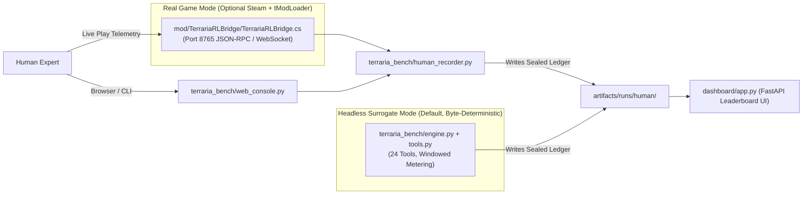

# Teammate 4 — Real Game Bridge (`tModLoader` C# Mod), Human Telemetry Recorder, Operator Web Console, Leaderboard Dashboard & Packaging

## 1. Mission & Scope

You own **Track 4 (Real Game Bridge, Human Reference Tooling, Live Dashboard & Reproducible Packaging)** of **TerrariaBench**.
The headless world engine ([engine.py](file:///C:/Users/natha/dev/TerrariaBench/terraria_bench/engine.py)), task lenses ([tasks.py](file:///C:/Users/natha/dev/TerrariaBench/terraria_bench/tasks.py)), composite grader ([grader.py](file:///C:/Users/natha/dev/TerrariaBench/terraria_bench/grader.py)), cryptographic provenance ([provenance.py](file:///C:/Users/natha/dev/TerrariaBench/terraria_bench/provenance.py)), and the 24-tool `Episode` surface ([tools.py](file:///C:/Users/natha/dev/TerrariaBench/terraria_bench/tools.py)) are already implemented and frozen.

Your responsibility is to build:
1. The **C# `tModLoader` Bridge Mod (`mod/TerrariaRLBridge/`)** that pauses the real game between operations, executes 60Hz micro-controller bursts, and exposes JSON-RPC/WebSocket port `8765`.
2. The **Human Playthrough Recorder & Replayer (`terraria_bench/human_recorder.py`)** and **Human Operator Web Console (`terraria_bench/web_console.py`)** mirroring StoreBench §5 (so humans play under the exact same 24 tools, operation budgets, and grading as AI agents).
3. The **FastAPI Live Leaderboard & Trajectory Inspector Dashboard (`dashboard/app.py`)**.
4. The **Project Packaging & Judge Reproduction Files (`Makefile`, `Dockerfile`, `README.md`)**.

### Files You Own (No Overlap With Teammates 1, 2, 3)
| File Path | Purpose |
| :--- | :--- |
| `mod/TerrariaRLBridge/build.txt` | tModLoader mod metadata (`displayName`, `author`, `version`) |
| `mod/TerrariaRLBridge/description.txt` | Mod description for tModLoader |
| `mod/TerrariaRLBridge/TerrariaRLBridge.cs` | Complete C# `ModSystem` hooking `PostUpdateEverything()`, pausing world ticks while awaiting agent ops, executing A*/combat bursts, and logging human gameplay over port `8765` |
| `terraria_bench/human_recorder.py` | Records live C# bridge telemetry or console sessions into `.jsonl` trajectories + SHA-256 sealed ledgers, and replays them byte-for-byte |
| `terraria_bench/web_console.py` | Thin browser/CLI Human Operator Console over the 24 tools (`Episode`) matching StoreBench §5 |
| `dashboard/app.py` | FastAPI + single-page HTML/JS Live Leaderboard & Trajectory Replay UI |
| `Makefile` | `make install`, `make calibrate`, `make eval`, `make test-exploits`, `make train-gemma`, `make dashboard` |
| `Dockerfile` | Reproducible container image for sandboxed evaluation |
| `README.md` | One-command judge verification guide, architecture overview, and Windows/Linux CLI equivalents |

---

## 2. System Architecture & Integration



---

## 3. Detailed Module Specifications

### 3.1 `mod/TerrariaRLBridge/` — C# tModLoader Mod

1. **`mod/TerrariaRLBridge/build.txt`**:
   ```ini
   displayName = TerrariaBench RL & MCP Bridge
   author = TerrariaBench Team
   version = 0.1.0
   ```
2. **`mod/TerrariaRLBridge/description.txt`**:
   Short explanation of the metered-time pause hook (`ModSystem.PostUpdateEverything`), the 24 macro-operation executors, and the port `8765` JSON-RPC bridge.
3. **`mod/TerrariaRLBridge/TerrariaRLBridge.cs`**:
   - Subclasses `Terraria.ModLoader.Mod` and `Terraria.ModLoader.ModSystem`.
   - Implements deterministic tick metering:
     - Maintains `pendingBurstTicks`, `windowTicksElapsed` (out of `27000` ticks = 12 in-game hours at 60Hz), and `opsLeft`.
     - When `pendingBurstTicks == 0` and the bridge is in metered agent mode, freezes world progression (`Main.time` held fixed, hostile AI velocity frozen) until the next JSON-RPC command arrives on `http://127.0.0.1:8765/` (using `System.Net.HttpListener` / WebSocket upgrade).
     - Dispatches all 24 tool names (`TOOL_NAMES` from `tools.py`), advancing `pendingBurstTicks` by the operation's burst duration (e.g., `0` for `terraria_status`, `180` for `engage_combat_burst`, up to `300` for `navigate_to`, or `27000 - windowTicksElapsed` for `end_window`).
     - Includes a **Human Telemetry Logger** mode that observes human player actions (movement, mining, crafting, building, combat, potion usage) per 12-hour window and streams structured macro-events to `human_recorder.py`.
   - *Note*: Since judge machines may not have `.NET 8` / `tModLoader` / Steam installed locally, document clearly in `README.md` that the C# mod is for live-game visualization and human capture, while `engine.py` is the default headless deterministic backend.

---

### 3.2 `terraria_bench/human_recorder.py` — Human Playthrough Recorder & Replayer

1. **Recording Format (`.jsonl`)**:
   - Each line in a trajectory `.jsonl` file records one step:
     ```json
     {"step": 1, "window": 1, "tool": "chop_trees", "args": {"radius": 28, "max_trees": 3}, "header": "[...]", "phi": 5.4}
     ```
   - Final line (or companion `.ledger.json` file) stores the SHA-256 sealed episode ledger produced by `ep.finalize(calibration)`.
2. **Core Functions**:
   - `record_from_bridge(task_id: str, seed: int, host: str = "127.0.0.1", port: int = 8765, out_path: Path | None = None) -> dict`: connects to the C# mod (or simulates bridge events during offline testing), mirrors macro-actions onto an `Episode(task_id, seed)` so grading uses the exact same sealed ledger format, and writes `artifacts/runs/human/<task_id>_seed<seed>.json`.
   - `replay_trajectory(jsonl_path: Path, calibration: dict | None = None) -> dict`: reads a recorded `.jsonl` action sequence, replays every `(tool, args)` step on a fresh `Episode(task_id, seed)`, verifies that the resulting ledger hash matches the recorded `sha256` byte-for-byte, and returns `grade(ledger, cell)`.
   - CLI entrypoint (`python -m terraria_bench.human_recorder --replay <path>` or `--verify-all`).

---

### 3.3 `terraria_bench/web_console.py` — Human Operator Console (StoreBench §5)

In StoreBench §5, human experts operated the store through a thin client over the exact same MCP tool surface, operation budgets, and task briefings as the LLM agents, with no privileged information (`task.sla` and silent events hidden).
Build `web_console.py` with:
1. **FastAPI Web UI (`python -m terraria_bench.web_console --task first-night --seed 7 --port 8080`)**:
   - Displays the task briefing (`ep.task.prompt`), the 1-line status header, the `61x35` ASCII/PNG viewport from `observe_viewport`, current inventory/equipment, and a clean form to invoke any of the 24 tools in `TOOL_SCHEMAS`.
   - Automatically saves the finalized sealed ledger to `artifacts/runs/human/<task>_seed<seed>.json` when the episode completes.
2. **Interactive CLI Fallback (`--cli`)**:
   - Allows playing a task in the terminal and exporting a graded human trajectory.

---

### 3.4 `dashboard/app.py` — FastAPI Live Leaderboard & Trajectory Inspector

Expose `app = FastAPI(title="TerrariaBench Leaderboard & Audit Console")`:
1. **Endpoints**:
   - `GET /`: Renders a responsive, self-contained HTML/CSS/JS dashboard displaying:
     - **StoreBench Table 1 Leaderboard** (Composite, Pass Rate, Business, Reliability, Continuity across the 6 scripted anchors, Frontier LLMs, and Human Reference).
     - **StoreBench Table 3 Post-Training Transfer** (Gemma Base vs. GRPO-Tuned).
     - **Per-Task × Seed Heatmap** showing calibrated `(z, s, threshold)` and gate verification status from `artifacts/calibration.json`.
     - **Interactive Episode Replay Viewer** showing window-by-window $\Phi(s_t)$ curves, SLA checkpoint pass/fail badges, and the 11 closed reward exploits (`grader.EXPLOITS`).
   - `GET /api/leaderboard`: Returns JSON leaderboard computed live from `artifacts/calibration.json` and `artifacts/runs/`.
   - `GET /api/calibration`: Returns the sealed `artifacts/calibration.json` payload and verification status (`verify_seal`).
   - `GET /api/exploits`: Returns the 11-entry `EXPLOITS` catalogue from `grader.py`.

---

### 3.5 `Makefile`, `Dockerfile`, and `README.md`

1. **`Makefile`**:
   Provide targets that work on Linux/macOS/Git-Bash (`make install`, `make calibrate`, `make eval`, `make test-exploits`, `make train-gemma`, `make dashboard`), delegating to `python -m ...`.
2. **`Dockerfile`**:
   Pinned `python:3.11-slim` image that installs `pyproject.toml`, copies the repo, runs `python -m terraria_bench.calibrate`, and defaults to `python -m terraria_bench.harness.runner --eval-standard`.
3. **`README.md`**:
   - Clear 1-command quickstart for both **POSIX (`make ...`)** and **Windows PowerShell (`python -m ...` / `uv run ...`)** since Windows laptops often lack `make`.
   - Architectural mapping table showing the 1-to-1 correspondence between **StoreBench (`arXiv:2610.10942v2`)** and **TerrariaBench**.
   - Transparent notes on:
     - Headless deterministic surrogate (`engine.py`) vs. C# `tModLoader` bridge (`mod/TerrariaRLBridge/`).
     - Header seed redaction (`Episode(..., redact_seed=True)`) to satisfy StoreBench Appendix F leak-audit rules.
     - How live LLM API keys (`GEMINI_API_KEY`, `NVIDIA_API_KEY`, `OPENROUTER_API_KEY`) and human trajectory recordings are loaded without ever fabricating benchmark numbers.

---

## 4. Verification Checklist Before Merging

Run:
```powershell
python -m terraria_bench.human_recorder --help
python -m uvicorn dashboard.app:app --port 8000
```
- [ ] `GET http://127.0.0.1:8000/api/leaderboard` and `GET http://127.0.0.1:8000/api/exploits` return `200 OK` with valid JSON.
- [ ] Recording and replaying a trajectory via `human_recorder.py` reproduces the sealed ledger `sha256` byte-for-byte.
- [ ] `README.md`, `Makefile`, and `Dockerfile` match all CLI module paths across Tracks 1–4.
